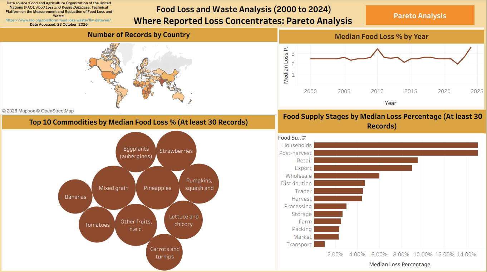
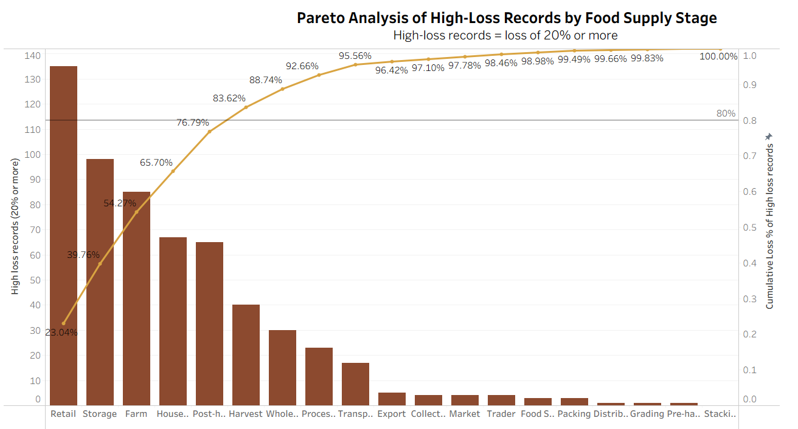

## **Food Loss and Waste Analysis (2000-2024)**

### **Where Reported Loss Concentrates: Pareto Analysis**

**Project Overview:** This project analyses the FAO Food Loss and Waste Database (2000 to 2024) to examine reported food-loss patterns across countries, commodities, years, and supply-chain stages.  It uses 21,777 records from 115 countries across 19 supply-chain stages, and the findings are presented in an interactive Tableau Public dashboard. Pareto analysis of high-loss records (reported loss of 20% or more) identifies the stages where they concentrate.

## Tools 

| Stage | Tool |
|---|---|
| Data cleaning and preparation | Microsoft Excel |
| Data visualisation and interactive dashboard| Tableau Public |
| Pareto analysis of high-loss records | Tableau Public |

## **Data**

* Data source: Food and Agriculture Organization of the United Nations (FAO). Food Loss and Waste Database. Technical Platform on the Measurement and Reduction of Food Loss and Waste.
* [FAO Food Loss and Waste Database](https://www.fao.org/platform-food-loss-waste/flw-data/en/)
* Accessed: 23 October 2026

## **Methodology**

1. **Data Collection:** Obtained the FAO Food Loss and Waste Database, covering reported food-loss observations from 2000 to 2024.

2. **Data Cleaning:** Removed exact duplicate records and records with missing food supply-chain stages, reducing the dataset from 31,455 raw rows to 27,884 rows. Retained nine relevant fields out of the original 18 columns for analysis.

3. **Data Filtering in Tableau:** Excluded whole-supply-chain records and World/regional aggregates to avoid double counting and improve comparability. The final analysis dataset contained 21,777 records from 115 countries across 19 supply-chain stages.

4. **Data Analysis:** Examined reported food-loss patterns by country, year, commodity, and supply-chain stage. Used record counts for  country-level data coverage.

5. **Statistical Analysis:** Used median reported loss percentages to compare years, commodities, and supply-chain stages because the loss-percentage data are skewed. Applied a minimum of 30 records for the commodity and supply-chain-stage comparisons where specified.

6. **Pareto Analysis:** Classified records with reported food loss of 20% or more as high-loss records, using a project-defined threshold. Counted these records by supply-chain stage and calculated cumulative percentages to identify the stages accounting for the largest share of high-loss records.

7. **Dashboard:** Built an interactive Tableau Public dashboard to present the number of records by  country, median loss % by year,  top 10 commodities by median loss % (at least 30 observations), food supply stage by median loss % (at least 30 records), and the Pareto analysis.

8. **Validation and Interpretation:** Checked reported findings against the cleaned data and documented limitations, including uneven record coverage and unweighted medians.
## Dashboard Preview


Dashboard:https://public.tableau.com/views/FoodLossandWasteAnalysis/FoodLossandWasteAnalysis

**Key Insights**

* The median reported loss is 2.5% across 21,777 records.
* Post-harvest and household stages stand out. Both reach a 15.00% median, followed by Retail at 9.50%. Transport records the lowest loss at 1.00%.
* Among commodities with at least 30 records, Mixed grain (12.00%), Pineapples (11.52%), and Other fruits, n.e.c. (10.85%)  rank highest.
* The number of records by country is uneven. India (1,233 records), Ethiopia (992), and Kenya (909) dominate, which limits country-level comparison.
  
## Pareto Analysis


Pareto Analysis: https://public.tableau.com/views/FoodLossandWasteAnalysis/ParetoAnalysisofHigh-LossRecordsbyFoodSupplyStage
A record is classified as high-loss when its reported loss is 20% or more. This is a project-defined threshold, used only for the Pareto analysis. 
**Key Insights**
A Pareto analysis of the 586 high-loss records (20% or more) showed that six of the 19 stages account for 83.6% of them, with Retail the largest at 23%.
High-loss records are concentrated. Out of 586 high-loss records, six stages hold 83.62%: Retail, Storage, Farm, Households, Post-harvest, and Harvest.
Retail is the largest contributor. It accounts for 135 records (23.0%).
The 80% line is crossed at the sixth stage. The first five stages cover 76.79%, and adding Harvest makes the total 83.62%.


## **Limitations**

* Medians are not weighted by production volume, so they show reported loss.
* Some countries, commodities, and stages have few records, so their medians are less stable, and years 2022 to 2024 also have fewer records.
* Loss and waste are reported in a single field, `loss_percentage`.
* Whole-supply-chain, World, and regional aggregate rows are excluded to avoid double counting.
* A record is classified as high-loss when its reported loss is 20% or more. This is a project-defined threshold, used only for pareto analysis.

## Repository Contents

```
food-loss-waste-analysis/
├── README.md
├── docs/
│   └── Food_Loss_and_Waste_Analysis_Report.pdf
└── images/
    ├── dashboard.png
    └── pareto.png
```

Made by: Navita Arora

